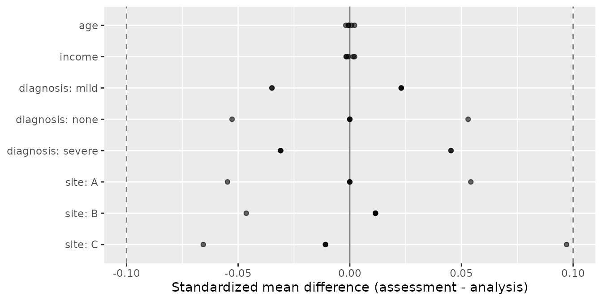

# Get started with balancesample

This article walks through a modeling project with balancesample: a
balanced training/testing split, balanced folds on the training set,
tuning with tune, and a final fit. It also shows how to choose the
columns to balance, how to check the result, and how to choose a method.

## The data

The example uses simulated data from 300 patients at three sites. Age
and income are skewed, and diagnosis has a rare level. The outcome
depends on age, income, and diagnosis.

``` r

library(balancesample)

set.seed(2026)
n <- 300
d <- data.frame(
  age = rgamma(n, shape = 4, rate = 0.1),
  income = rlnorm(n, meanlog = 10, sdlog = 0.6),
  diagnosis = factor(sample(
    c("none", "mild", "severe"),
    n,
    replace = TRUE,
    prob = c(0.6, 0.3, 0.1)
  )),
  site = factor(sample(c("A", "B", "C"), n, replace = TRUE))
)
severe <- d$diagnosis == "severe"
d$outcome <- 0.05 * d$age + 0.3 * log(d$income) + 1.5 * severe + rnorm(n)
```

## Why balance?

In tidymodels, a modeling project usually starts with
[`rsample::initial_split()`](https://rsample.tidymodels.org/reference/initial_split.html),
which holds out a test set, and
[`rsample::vfold_cv()`](https://rsample.tidymodels.org/reference/vfold_cv.html),
which makes cross-validation folds from the training set. Both take
`strata`, which stratifies on one column: each set gets about the same
share of each of its levels. (By default, a numeric column with more
than five distinct values is first cut into up to four bins. Otherwise,
the rows of levels with under 10% of the rows are spread at random over
the other levels.) But what if you want the sets to be similar on
several variables at once? Here, we might want every fold to have
similar ages, incomes, diagnoses, and sites. With 300 rows and 10 folds,
each held-out fold has only about 30 rows, so folds stratified on
diagnosis alone can still differ on the other variables, as the output
below shows.

[`balance_check()`](https://jmgirard.github.io/balancesample/reference/balance_check.md)
measures how similar the sets are. For each fold, it compares the
held-out rows with the other rows in two ways:

- The standardized mean difference (SMD) is computed for each variable
  on its own. It is the difference in means (held-out rows minus the
  other rows) divided by the pooled standard deviation. For a
  categorical variable, there is one SMD per level, from the proportions
  of that level. An absolute SMD under 0.1 is a common rule of thumb for
  good balance.
- The energy distance compares all the variables at once. It turns each
  level of a categorical variable into a 0/1 column, standardizes all
  the columns, and then looks at the distances between rows. It is twice
  the average distance between a row of one set and a row of the other,
  minus the average distance between two rows of the same set (once for
  each set, counting each row paired with itself). It is 0 when the two
  sets have the same distribution, and it grows as they differ. Unlike
  the SMD, it also picks up differences in spread and shape, and in how
  the variables relate to each other. It has no fixed cutoff like 0.1,
  so use it to compare splits of the same data on the same variables.

For each fold,
[`balance_check()`](https://jmgirard.github.io/balancesample/reference/balance_check.md)
returns one SMD row per numeric variable, one per level of each
categorical variable, and one energy row.
[`summary()`](https://rdrr.io/r/base/summary.html) turns this into one
row per fold, with the largest absolute SMD, the variable and level it
belongs to, and the energy distance. Here are ordinary folds from
rsample, stratified on diagnosis. For these, you list the columns to
check:

``` r

random_folds <- rsample::vfold_cv(d, v = 10, strata = diagnosis)
random_check <- balance_check(random_folds, age, income, diagnosis, site)
summary(random_check)
#> # A tibble: 10 × 5
#>    id     max_abs_smd variable level energy
#>    <chr>        <dbl> <chr>    <chr>  <dbl>
#>  1 Fold01       0.349 income   NA    0.0695
#>  2 Fold02       0.171 age      NA    0.0696
#>  3 Fold03       0.158 site     C     0.0707
#>  4 Fold04       0.239 site     A     0.0771
#>  5 Fold05       0.191 site     B     0.0946
#>  6 Fold06       0.198 age      NA    0.0877
#>  7 Fold07       0.109 site     A     0.0943
#>  8 Fold08       0.575 site     A     0.204 
#>  9 Fold09       0.527 site     A     0.193 
#> 10 Fold10       0.258 income   NA    0.0925
```

And here are balanced folds. `balance` lists the columns to make
similar, and `exact` takes the place of `strata`. The next section
explains both. Balanced folds remember these columns, so
[`balance_check()`](https://jmgirard.github.io/balancesample/reference/balance_check.md)
needs no column list:

``` r

folds <- balanced_vfold_cv(
  d,
  v = 10,
  balance = c(age, income),
  exact = c(diagnosis, site)
)
balanced_check <- balance_check(folds)
summary(balanced_check)
#> # A tibble: 10 × 5
#>    id     max_abs_smd variable  level  energy
#>    <chr>        <dbl> <chr>     <chr>   <dbl>
#>  1 Fold01      0.115  diagnosis severe 0.0528
#>  2 Fold02      0.119  diagnosis mild   0.0634
#>  3 Fold03      0.0545 site      C      0.0412
#>  4 Fold04      0.115  diagnosis severe 0.0687
#>  5 Fold05      0.0545 site      A      0.0442
#>  6 Fold06      0.0995 site      C      0.0663
#>  7 Fold07      0.113  site      B      0.0627
#>  8 Fold08      0.0496 site      B      0.0488
#>  9 Fold09      0.0496 site      B      0.0454
#> 10 Fold10      0.104  diagnosis severe 0.0501
```

The largest absolute SMD in any fold fell from 0.58 to 0.12, and the
mean energy distance fell from 0.105 to 0.054. What is left is mostly in
the category proportions. These can’t come out exactly equal when a
level’s count doesn’t divide evenly into 10 folds.

## Choosing columns: `balance` and `exact`

`balance` takes numeric and categorical columns. To compare the sets,
the method turns each level of a categorical column into a 0/1 column
and standardizes all the columns. This happens only inside the method:
your data and the splits keep the original columns. The method then
makes the sets as similar as it can on all of these columns at once.
This is a goal, not a rule, so the method may trade a little balance on
one column for more balance on another.

`exact` takes categorical columns and is a rule. Each combination of
levels is one stratum. In each set, the count of each stratum is its
share of that set, rounded up or down to a whole row. This is fixed
before the method runs, so it holds for every method.

`exact` does the job of `strata` in rsample, with two differences. It
can take several columns, which it crosses, and its counts are exact
rather than approximate. If you write `strata` out of habit,
balancesample stops and tells you to use `exact`.

A categorical column can go in either argument. Use `exact` when you
need the counts as close as whole rows allow. Use `balance` when close
is enough. In the folds above, diagnosis is in `exact` because the
outcome depends on it, and severe cases are rare. Site is in `exact` so
that each site is represented in proportion in every fold, and later in
the test set. If a slightly uneven mix of sites were fine, site could go
in `balance` instead.

Continuous columns belong in `balance`. If you need exact counts within
ranges of a continuous column, make a factor of those ranges and put
that in `exact`. Base R has [`cut()`](https://rdrr.io/r/base/cut.html).
In the tidyverse,
[`ggplot2::cut_number()`](https://ggplot2.tidyverse.org/reference/cut_interval.html)
makes ranges with about the same number of rows, and
[`ggplot2::cut_interval()`](https://ggplot2.tidyverse.org/reference/cut_interval.html)
and
[`ggplot2::cut_width()`](https://ggplot2.tidyverse.org/reference/cut_interval.html)
make ranges of the same width.
[`dplyr::ntile()`](https://dplyr.tidyverse.org/reference/ntile.html)
also works: it returns whole numbers, which `exact` treats as
categories.

What about the outcome? In rsample, `strata` is usually the outcome, so
that every set has a similar mix of outcomes. You can do the same here.
A numeric outcome can go in `balance`, next to the predictors, and a
class outcome can go in `exact` if the class counts matter and every
class has enough rows for every set. The outcome is used only to assign
rows to sets, as with `strata`. This assumes you have the outcome when
you make the split. If the evaluation must hold out whole time periods
or whole sites, split by those instead: put the site in `group`, or use
rsample’s time-based splits. In this article, the outcome depends on
age, income, and diagnosis, so balancing those already keeps the outcome
similar across the sets, and it is left out.

Each column you add to `exact` splits the strata further. Here diagnosis
and site together make 9 strata:

``` r

tab <- table(d$diagnosis, d$site)
tab
#>         
#>           A  B  C
#>   mild   24 33 27
#>   none   68 43 65
#>   severe 15 10 15
```

The smallest stratum is severe cases at site B, with 10 patients. After
an 80% training split, 8 of them are spread over 5 folds, so each fold
gets 1 or 2. A stratum with fewer rows than folds is missing from some
folds. Small strata also leave the method less room to balance the other
columns.

### Missing values

The columns in `balance`, `exact`, and `group` must not have missing
values. If a `balance` column has some, you can balance on a filled copy
of it and on an indicator of which values were missing. Here, 30 incomes
are missing. The median fills them, and `income_missing` makes sure the
missing incomes are spread over the folds too:

``` r

d_na <- d
d_na$income[sample(n, 30)] <- NA
d_na$income_filled <- d_na$income
d_na$income_filled[is.na(d_na$income)] <- median(d_na$income, na.rm = TRUE)
d_na$income_missing <- is.na(d_na$income)
folds_na <- balanced_vfold_cv(
  d_na,
  v = 10,
  balance = c(age, income_filled, income_missing),
  exact = c(diagnosis, site)
)
```

The filled copy is only for making the split. Your model can handle the
missing values its own way, for example with a recipe.
[`balance_check()`](https://jmgirard.github.io/balancesample/reference/balance_check.md)
drops missing values variable by variable, so you can check the original
column:

``` r

na_check <- balance_check(folds_na, age, income, income_missing)
summary(na_check)
#> # A tibble: 10 × 5
#>    id     max_abs_smd variable level energy
#>    <chr>        <dbl> <chr>    <chr>  <dbl>
#>  1 Fold01    0.00356  income   NA    0.0314
#>  2 Fold02    0.00596  income   NA    0.0346
#>  3 Fold03    0.00508  income   NA    0.0699
#>  4 Fold04    0.00980  income   NA    0.0271
#>  5 Fold05    0.00586  income   NA    0.0459
#>  6 Fold06    0.0106   income   NA    0.0547
#>  7 Fold07    0.00146  age      NA    0.0371
#>  8 Fold08    0.000956 income   NA    0.0401
#>  9 Fold09    0.00395  age      NA    0.0326
#> 10 Fold10    0.0299   income   NA    0.0875
```

For a categorical column, you can instead make a copy with its own level
for missing values, for example with `forcats::fct_na_value_to_level()`,
and put that in `balance` or `exact`.

## A full tidymodels workflow

Start with a balanced training/testing split, with the same columns as
above. Then make balanced folds from the training set only, so the test
set plays no part in tuning.

``` r

split <- balanced_initial_split(
  d,
  prop = 0.8,
  balance = c(age, income),
  exact = c(diagnosis, site)
)
train <- rsample::training(split)
balance_check(split)
#> # Balance check: 1 split, max |SMD| = 0.0373, mean energy distance = 0.0228
#> # A tibble: 9 × 5
#>   id    variable  level  statistic      value
#>   <chr> <chr>     <chr>  <chr>          <dbl>
#> 1 Split age       NA     smd       -0.0000573
#> 2 Split income    NA     smd       -0.0000176
#> 3 Split diagnosis mild   smd       -0.0373   
#> 4 Split diagnosis none   smd        0.0339   
#> 5 Split diagnosis severe smd        0        
#> 6 Split site      A      smd        0.0260   
#> 7 Split site      B      smd       -0.00923  
#> 8 Split site      C      smd       -0.0174   
#> 9 Split NA        NA     energy     0.0228
```

A single split has few enough rows to read in full. The last row is the
energy distance.

``` r

folds <- balanced_vfold_cv(
  train,
  v = 5,
  balance = c(age, income),
  exact = c(diagnosis, site)
)
```

Use
[`autoplot()`](https://ggplot2.tidyverse.org/reference/autoplot.html) to
see the SMD of every variable in every fold. The dashed lines are at
-0.1 and 0.1.

``` r

library(ggplot2)
autoplot(balance_check(folds))
```



A diagnosis level can land outside the lines even though diagnosis is in
`exact`. The counts are exact for each diagnosis and site combination. A
fold can be one row off in each of the three sites, and these rows add
up for the diagnosis as a whole. Rare levels show this most, because one
row is a large share of a small level.

The folds work with tune like any other `rset`, as long as balancesample
is attached with [`library()`](https://rdrr.io/r/base/library.html), as
in the chunk below. tune finds the function that made the folds by its
name, so it fails if you only call
[`balancesample::balanced_vfold_cv()`](https://jmgirard.github.io/balancesample/reference/balanced_vfold_cv.md).

This example tunes the depth and the minimum node size of a decision
tree:

``` r

library(balancesample)
library(parsnip)
library(tune)
library(workflows)

wf <- workflow(
  outcome ~ age + income + diagnosis + site,
  decision_tree(
    tree_depth = tune(),
    min_n = tune(),
    mode = "regression"
  )
)
res <- tune_grid(wf, resamples = folds, grid = 6)
show_best(res, metric = "rmse", n = 3)
#> # A tibble: 3 × 8
#>   tree_depth min_n .metric .estimator  mean     n std_err .config        
#>        <int> <int> <chr>   <chr>      <dbl> <int>   <dbl> <chr>          
#> 1          3    40 rmse    standard    1.13     5  0.0693 pre0_mod2_post0
#> 2          9    24 rmse    standard    1.15     5  0.0454 pre0_mod4_post0
#> 3         12     9 rmse    standard    1.15     5  0.0451 pre0_mod5_post0
```

Finalize the workflow with the settings that had the lowest
cross-validated RMSE. Then
[`last_fit()`](https://tune.tidymodels.org/reference/last_fit.html) fits
it on the whole training set and evaluates it on the test set:

``` r

final <- finalize_workflow(wf, select_best(res, metric = "rmse"))
final_fit <- last_fit(final, split)
collect_metrics(final_fit)
#> # A tibble: 2 × 4
#>   .metric .estimator .estimate .config        
#>   <chr>   <chr>          <dbl> <chr>          
#> 1 rmse    standard       1.08  pre0_mod0_post0
#> 2 rsq     standard       0.523 pre0_mod0_post0
```

## Choosing a method

balancesample has four methods. All of them keep the `exact` counts.
They differ in how they make the sets similar on the `balance` columns:

- `"anticlust"` (the default) uses k-plus anticlustering from the
  [anticlust](https://cran.r-project.org/package=anticlust) package
  ([Papenberg, 2024](https://doi.org/10.1111/bmsp.12315)). It starts
  from a random assignment and swaps rows of the same `exact` stratum
  between sets when the swap improves one score for how similar the
  means and variances of the sets are. By default, it considers every
  row of the same stratum as a swap partner, so its run time grows
  quickly with the number of rows.
- `"twinning"` uses data twinning from the
  [twinning](https://cran.r-project.org/package=twinning) package
  ([Vakayil and Joseph, 2022](https://doi.org/10.1002/sam.11574)). It
  takes one set out of the data at a time. It takes a row and its
  nearest unused neighbours as a small group and keeps that first row
  for the set. The next group starts at the unused row closest to the
  last group’s farthest neighbour, so the set covers the data the way
  the whole data does. It does this within each `exact` stratum. For
  folds, the default strategy repeats this on the rows that are left. In
  one test with 10 folds, it took under 0.2 seconds for 1,000 to 10,000
  rows (see the README). It needs the twinning package, allows only some
  split proportions, and splits small strata at random (for folds,
  strata with fewer than `2 * v` rows).
- `"rerandomize"` uses rerandomization ([Morgan and Rubin,
  2012](https://doi.org/10.1214/12-AOS1008)). It draws stratified random
  splits and scores each one by its Mahalanobis imbalance: a distance
  between the means of the sets that takes the correlations between the
  columns into account. For folds, the score is the largest imbalance of
  any fold against the rest. It keeps the first draw that scores under a
  cutoff, set from 100 pilot draws so that about 10% of draws pass. If
  none of 1,000 draws passes, it uses the best one, with a warning. It
  balances means only, and needs no extra package.
- `"interaction"` cuts each numeric column into up to four bins by rank,
  crosses them with the levels of the categorical columns, and
  stratifies at random on the result. Within each `exact` stratum, cells
  with fewer than 10% of all the rows are pooled. Crossed cells get
  small fast: here, with age and income in quartiles and 9 `exact`
  strata, the largest cell has 8 rows and the cutoff is 30, so every
  cell is pooled and the folds are random within the `exact` strata. It
  is a baseline that shows how crossed strata become sparse.

This compares all four on the full data with 10 folds:

``` r

methods <- c("anticlust", "twinning", "rerandomize", "interaction")
by_method <- lapply(methods, function(m) {
  f <- balanced_vfold_cv(
    d,
    v = 10,
    balance = c(age, income),
    exact = c(diagnosis, site),
    method = m
  )
  s <- summary(balance_check(f))
  data.frame(
    method = m,
    max_abs_smd = max(s$max_abs_smd),
    mean_energy = mean(s$energy)
  )
})
by_method <- do.call(rbind, by_method)
shown <- by_method
shown[-1] <- round(shown[-1], 3)
shown
#>        method max_abs_smd mean_energy
#> 1   anticlust       0.134       0.059
#> 2    twinning       0.251       0.041
#> 3 rerandomize       0.268       0.055
#> 4 interaction       0.419       0.066
```

In this run, anticlust had the smallest `max_abs_smd` (0.134), and
twinning had the smallest `mean_energy` (0.041). These come from one run
of each method on one data set, so they don’t show which method does
best in general, and small differences may be noise.

Start with anticlust. On large data, set
`options = list(k_neighbours = 20)` or try twinning, then check the
balance again. With `k_neighbours = 20`, look at the categorical columns
in particular: in one test with 5,000 rows, their largest SMD rose from
about 0.005 to about 0.1, while the numeric columns stayed as well
balanced. The README lists run times for both. See
[`?balanced_vfold_cv`](https://jmgirard.github.io/balancesample/reference/balanced_vfold_cv.md)
for the options of each method.

## Groups

If the data have several rows per person, put the person ID in `group`.
All of a person’s rows then go to the same set. Columns in `exact` must
be constant within each person, and the exact counts are counts of
people, not rows. `group` works the same way in
[`balanced_initial_split()`](https://jmgirard.github.io/balancesample/reference/balanced_initial_split.md).

``` r

d$person <- seq_len(n)
long <- d[rep(seq_len(n), times = sample(1:4, n, replace = TRUE)), ]
grouped <- balanced_vfold_cv(
  long,
  v = 5,
  balance = c(age, income),
  exact = c(diagnosis, site),
  group = person
)
grouped
#> # 5-fold balanced cross-validation (anticlust), balancing age, income,
#> # stratified by diagnosis, site, grouped by person
#> # A tibble: 5 × 2
#>   splits            id   
#>   <list>            <chr>
#> 1 <split [578/145]> Fold1
#> 2 <split [578/145]> Fold2
#> 3 <split [579/144]> Fold3
#> 4 <split [579/144]> Fold4
#> 5 <split [578/145]> Fold5
```

The split sizes are numbers of rows. Each fold gets about the same
number of people, so the number of rows per fold varies with how many
rows each person has.
[`balance_check()`](https://jmgirard.github.io/balancesample/reference/balance_check.md)
also compares rows.
