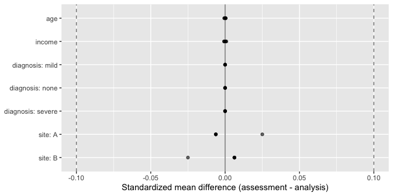

# balancesample

balancesample makes training/testing splits and cross-validation folds
that are similar on several variables at once. The results are
[rsample](https://rsample.tidymodels.org) objects, so you can use them
with tune and the rest of tidymodels.

rsample can stratify on one variable. If you need folds that match on
age, income, and diagnosis together, rsample cannot do that.
balancesample fills this gap with four methods:

| Method | What it does | Package |
|----|----|----|
| `"anticlust"` (default) | Anticlustering with the k-plus objective ([`anticlust::fast_anticlustering()`](https://m-py.github.io/anticlust/reference/fast_anticlustering.html)), which matches the means and variances of the sets. | [anticlust](https://cran.r-project.org/package=anticlust) |
| `"twinning"` | Data twinning, which splits the data into sets with similar distributions. | [twinning](https://cran.r-project.org/package=twinning) |
| `"rerandomize"` | Draws random splits and keeps the first one with a small Mahalanobis imbalance (Morgan and Rubin, 2012). | none |
| `"interaction"` | Crosses quantile bins of all variables and stratifies at random. This is a baseline. | none |

twinning is a suggested package. If you select `method = "twinning"` and
it is not installed, balancesample asks you to install it.

## Installation

Install the development version from GitHub:

``` r

# install.packages("pak")
pak::pak("jmgirard/balancesample")
```

## Example

This example uses simulated data with two skewed numeric variables and
two categorical variables.

``` r

library(balancesample)

set.seed(2026)
n <- 400
d <- data.frame(
  age = rgamma(n, shape = 4, rate = 0.1),
  income = rlnorm(n, meanlog = 10, sdlog = 0.6),
  diagnosis = sample(c("none", "mild", "severe"), n, TRUE, prob = c(0.6, 0.3, 0.1)),
  site = sample(c("A", "B"), n, TRUE)
)
d$outcome <- 0.05 * d$age + 0.3 * log(d$income) + rnorm(n)
```

[`balanced_vfold_cv()`](https://jmgirard.github.io/balancesample/reference/balanced_vfold_cv.md)
takes the columns to balance in `balance`. Categorical columns in
`exact` are stratified exactly: in each fold, the count of each level
combination is the floor or the ceiling of its proportional share of
that fold. With `group`, these are counts of groups, not rows.

``` r

folds <- balanced_vfold_cv(
  d,
  v = 5,
  balance = c(age, income, diagnosis),
  exact = site
)
folds
#> # 5-fold balanced cross-validation (anticlust), balancing age, income,
#> # diagnosis, stratified by site
#> # A tibble: 5 × 2
#>   splits           id   
#>   <list>           <chr>
#> 1 <split [320/80]> Fold1
#> 2 <split [320/80]> Fold2
#> 3 <split [320/80]> Fold3
#> 4 <split [320/80]> Fold4
#> 5 <split [320/80]> Fold5
```

[`balance_check()`](https://jmgirard.github.io/balancesample/reference/balance_check.md)
reports the standardized mean difference (SMD) of each variable in each
fold. The SMD compares the assessment set with the analysis set. It also
reports the energy distance, which compares the whole multivariate
distribution. The function works with any rsample object, so you can
compare balanced folds with ordinary folds. The printed table has one
row per fold: the largest absolute SMD and its variable, the mean over
the variables, how many are over 0.1, and the energy distance.
[`summary()`](https://rdrr.io/r/base/summary.html) returns the same
numbers as a tibble.

``` r

balance_check(folds)
#> # Balance check: 5 splits, 4 variables
#> # 0 of 5 splits have a variable with |SMD| > 0.1, mean energy distance 0.0203
#> 
#> id     max |SMD|  variable  mean |SMD|  over 0.1  energy
#> Fold1    0.00625  site: A      0.00191       0/4  0.018
#> Fold2    0.00625  site: A      0.00181       0/4  0.0287
#> Fold3    0.025    site: A      0.00657       0/4  0.0165
#> Fold4    0.00625  site: A      0.00174       0/4  0.0223
#> Fold5    0.00625  site: B      0.00167       0/4  0.016
#> 
#> # summary() gives this table as a tibble, and tibble::as_tibble() gives all
#> # 40 rows.

random_folds <- rsample::vfold_cv(d, v = 5)
balance_check(random_folds, age, income, diagnosis, site)
#> # Balance check: 5 splits, 4 variables
#> # 4 of 5 splits have a variable with |SMD| > 0.1, mean energy distance 0.0653
#> 
#> id     max |SMD|  variable         mean |SMD|  over 0.1  energy
#> Fold1     0.302   diagnosis: none      0.131        2/4  0.0878
#> Fold2     0.0968  income               0.0416       0/4  0.0284
#> Fold3     0.144   income               0.0843       1/4  0.0351
#> Fold4     0.288   diagnosis: none      0.181        2/4  0.113
#> Fold5     0.184   income               0.155        4/4  0.0622
#> 
#> # summary() gives this table as a tibble, and tibble::as_tibble() gives all
#> # 40 rows.
```

Use
[`autoplot()`](https://ggplot2.tidyverse.org/reference/autoplot.html) to
see the SMD values. The dashed lines are at -0.1 and 0.1.

``` r

library(ggplot2)
autoplot(balance_check(folds))
```



The folds work with tune. You must attach balancesample with
[`library()`](https://rdrr.io/r/base/library.html), because tune finds
the function that made the folds by its name.

``` r

library(tune)
library(parsnip)

res <- fit_resamples(
  linear_reg(),
  outcome ~ age + income + diagnosis,
  resamples = folds
)
collect_metrics(res)
#> # A tibble: 2 × 6
#>   .metric .estimator  mean     n std_err .config        
#>   <chr>   <chr>      <dbl> <int>   <dbl> <chr>          
#> 1 rmse    standard   1.01      5 0.00969 pre0_mod0_post0
#> 2 rsq     standard   0.504     5 0.0191  pre0_mod0_post0
```

[`balanced_initial_split()`](https://jmgirard.github.io/balancesample/reference/balanced_initial_split.md)
makes one balanced training/testing split.

``` r

split <- balanced_initial_split(d, prop = 3 / 4, balance = c(age, income), method = "twinning")
split
#> # Balanced training/testing split (twinning), balancing age, income
#> <Training/Testing/Total>
#> <300/100/400>
balance_check(split)
#> # Balance check: 1 split, 2 variables
#> # |SMD| > 0.1 in 0 of 2 variables, energy distance 0.00206
#> 
#> variable  level       SMD
#> age              -0.00875
#> income            0.0118
#> 
#> # tibble::as_tibble() gives all 3 rows.
```

[`balanced_initial_validation_split()`](https://jmgirard.github.io/balancesample/reference/balanced_initial_validation_split.md)
makes one balanced training/validation/testing split. Pass it to
[`rsample::validation_set()`](https://rsample.tidymodels.org/reference/validation_set.html)
to tune on the validation set.

``` r

split3 <- balanced_initial_validation_split(d, prop = c(0.6, 0.2), balance = c(age, income))
split3
#> # Balanced training/validation/testing split (anticlust), balancing age, income
#> <Training/Validation/Testing/Total>
#> <240/80/80/400>
balance_check(split3)
#> # Balance check: 2 splits, 2 variables
#> # 0 of 2 splits have a variable with |SMD| > 0.1, mean energy distance 0.0158
#> 
#> id          max |SMD|  variable  mean |SMD|  over 0.1  energy
#> Validation   1.84e-05  age         1.41e-05       0/2  0.0192
#> Testing      6.82e-05  age         5.02e-05       0/2  0.0124
#> 
#> # summary() gives this table as a tibble, and tibble::as_tibble() gives all 6
#> # rows.
```

## Groups

Use `group` to keep all rows of a group (for example, a participant or a
hospital) in the same set. Each group becomes one row with its group
means and its log size. The method assigns the groups, and each row then
gets the set of its group. The number of groups per set follows the
target proportions, so the number of rows per set is only approximate.

``` r

d$person <- sample(1:80, n, TRUE)
grouped <- balanced_vfold_cv(d, v = 5, balance = c(age, income), group = person)
grouped
#> # 5-fold balanced cross-validation (anticlust), balancing age, income,
#> # grouped by person
#> # A tibble: 5 × 2
#>   splits           id   
#>   <list>           <chr>
#> 1 <split [320/80]> Fold1
#> 2 <split [319/81]> Fold2
#> 3 <split [319/81]> Fold3
#> 4 <split [320/80]> Fold4
#> 5 <split [322/78]> Fold5
```

anticlust has a `must_link` argument for groups. balancesample does not
use it, because it needs fold sizes that the groups can fill exactly,
and it was slow in tests.

## Options

Pass method options in `options`. See
[`?balanced_vfold_cv`](https://jmgirard.github.io/balancesample/reference/balanced_vfold_cv.md)
for the options of each method.

``` r

balanced_vfold_cv(d, balance = c(age, income), options = list(moments = 4, k_neighbours = 20))
balanced_vfold_cv(d, v = 4, balance = c(age, income), method = "twinning", options = list(strategy = 2))
balanced_vfold_cv(d, balance = c(age, income), method = "rerandomize", options = list(p_accept = 0.01))
```

By default, anticlust tries every swap, so its run time grows quickly
with the number of rows. In one test on one computer, with 10 folds and
four numeric variables, it took 0.5 seconds for 1,000 rows, 3.7 seconds
for 3,000 rows, 25 seconds for 10,000 rows, and 3.6 minutes for 30,000
rows. With `k_neighbours = 20`, each row can only swap with its 20
nearest neighbours, and the same runs took 0.3, 1.6, 4.1, and 11.7
seconds. This costs little balance on numeric columns, but more on
categorical ones. In a test with 5,000 rows and a categorical column in
`balance`, the largest SMD of a numeric column was about 0.0002 either
way, but that of a category rose from about 0.005 to about 0.1. Twinning
took less than 0.5 seconds for all four sizes.

## Background

In 2021, I asked for multivariate stratification in rsample
([tidymodels/rsample#266](https://github.com/tidymodels/rsample/issues/266)).
Julia Silge suggested an extension package, and balancesample is that
package. Its design follows
[spatialsample](https://spatialsample.tidymodels.org): it builds folds
with
[`rsample::make_splits()`](https://rsample.tidymodels.org/reference/make_splits.html)
and
[`rsample::new_rset()`](https://rsample.tidymodels.org/reference/new_rset.html).

Two other rsample issues are related.
[tidymodels/rsample#371](https://github.com/tidymodels/rsample/issues/371)
proposes twinning as the multi-variable strata method for rsample.
[tidymodels/rsample#109](https://github.com/tidymodels/rsample/issues/109)
records Max Kuhn’s concern that crossed strata become sparse. The
`"interaction"` method is in balancesample so that you can see this
problem next to the other methods.

## Prior art

- `groupdata2::fold()` makes folds that balance one numeric variable,
  stratify one categorical variable, and keep groups together.
- `groupdata2::collapse_groups()` combines existing groups into fewer
  groups that are similar in size and in several numeric and categorical
  variables.
- `splitTools::multi_strata()` makes one stratification variable from
  several variables, by crossing them or by k-means clustering.

## References

Morgan, K. L., & Rubin, D. B. (2012). Rerandomization to improve
covariate balance in experiments. *The Annals of Statistics, 40*(2),
1263-1282.

Papenberg, M. (2024). K-plus anticlustering: An improved k-means
criterion for maximizing between-group similarity. *British Journal of
Mathematical and Statistical Psychology, 77*(1), 80-102.

Papenberg, M., & Klau, G. W. (2021). Using anticlustering to partition
data sets into equivalent parts. *Psychological Methods, 26*(2),
161-174.

Vakayil, A., & Joseph, V. R. (2022). Data twinning. *Statistical
Analysis and Data Mining, 15*(5), 598-610.
